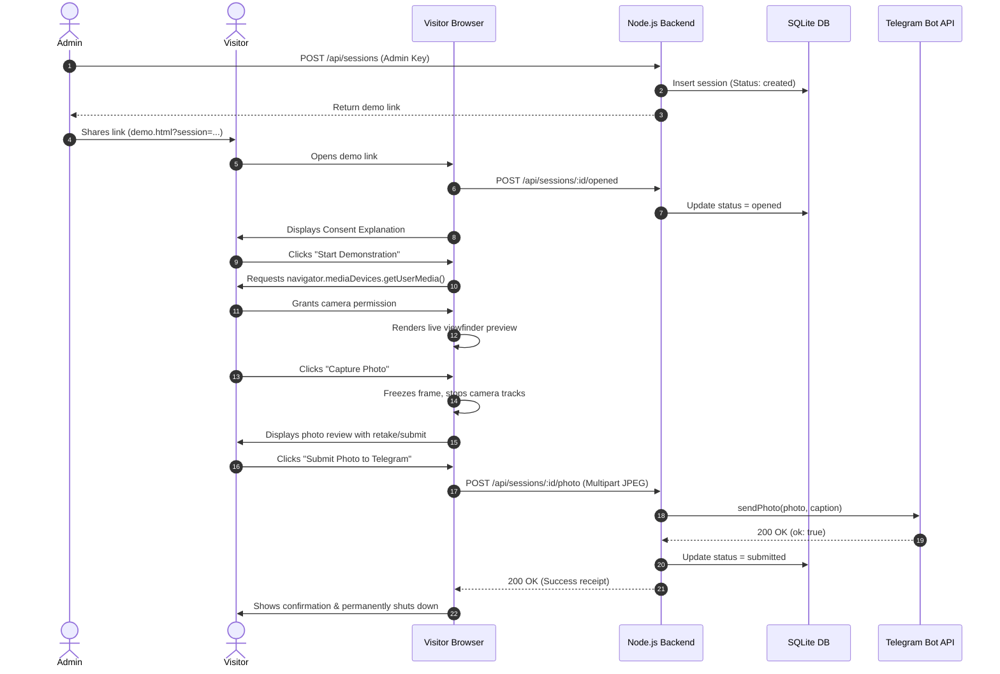

# Cross-Platform Camera Security Demonstration Platform

[](https://nodejs.org/)
[](https://expressjs.com/)
[](https://www.sqlite.org/)
[](https://core.telegram.org/bots/api#sendphoto)
[](https://nodejs.org/api/test.html)

A professional, consent-based Camera Security Demonstration platform designed to evaluate browser camera permission models across desktop and mobile browsers.

The platform allows an administrator to generate unique, cryptographically signed, time-bounded demonstration links. When a visitor opens the link, the application explains the demonstration, requests permission via `navigator.mediaDevices.getUserMedia()`, renders a live video preview, and enables explicit capture, review, and photo submission to the administrator's private Telegram chat.

> [!IMPORTANT]
> **Strict Consent Protocol**: This is an educational and security demonstration platform. It incorporates **zero hidden capture**, **no automatic transmission**, **no permission bypasses**, and **no covert tracking**. Transmissions occur only after explicit visitor confirmation.

---

## Browser Compatibility

| Platform | Browsers | Support | Notes |
| :--- | :--- | :--- | :--- |
| **Apple iOS & iPadOS** | Safari, Chrome, Edge, Firefox | Supported | Requires HTTPS. Front/rear toggle supported. |
| **Android** | Chrome, Firefox, Edge, Brave, Samsung Internet | Supported | Requires HTTPS. Front/rear switch supported. |
| **Windows Desktop** | Chrome, Edge, Firefox, Brave, Opera | Supported | Webcam framing reticle and mirror mode. |
| **macOS Desktop** | Safari, Chrome, Firefox, Edge | Supported | Built-in FaceTime and external webcams supported. |
| **Linux Desktop** | Chrome, Firefox | Supported | Standard V4L2 webcams supported. |

---

## Architectural Overview

The repository is organized into two decoupled applications:

```text
├── frontend/                     # Pure static HTML5/CSS3/Vanilla JS (GitHub Pages ready)
│   ├── index.html                # Admin security dashboard
│   ├── demo.html                 # Visitor camera demonstration page
│   ├── style.css                 # Dark navy & charcoal security design system
│   ├── app.js                    # Admin dashboard logic, session polling & link copying
│   ├── demo.js                   # MediaDevices stream, viewfinder, snapshot & review logic
│   └── config.js                 # Public backend URL resolver (Zero secrets)
├── backend/                      # Production Node.js & Express REST API
│   ├── server.js                 # Express server with Helmet, CORS & Rate Limiting
│   ├── package.json              # Backend dependencies & test scripts
│   ├── .env.example              # Environment variables template
│   ├── routes/
│   │   ├── sessions.js           # Session generation, verification & revocation
│   │   └── photos.js             # Multipart upload, MIME check & Telegram delivery
│   ├── services/
│   │   ├── db.js                 # Persistent SQLite database layer
│   │   └── telegram.js           # Telegram Bot API sendPhoto integration
│   ├── middleware/
│   │   ├── auth.js               # Timing-safe Administrator API key middleware
│   │   └── errorHandler.js       # Centralized error & 404 handler
│   └── tests/                    # Automated test suites (node:test & Supertest)
│       ├── sessions.test.js      # Session lifecycle & authentication tests
│       ├── photos.test.js        # Photo submission & Mocked Telegram tests
│       └── security.test.js      # CORS, Helmet & health check tests
├── docs/                         # In-depth operational guides
│   ├── API_DOCUMENTATION.md      # Full REST API specification with examples
│   ├── GITHUB_PAGES_DEPLOYMENT.md# Guide for hosting frontend on GitHub Pages
│   ├── BACKEND_DEPLOYMENT.md     # Production deployment (Render, Railway, VPS)
│   ├── TELEGRAM_BOT_SETUP.md     # Step-by-step BotFather & Chat ID guide
│   ├── SECURITY_CHECKLIST.md     # Comprehensive security & privacy checklist
│   └── TROUBLESHOOTING.md        # Camera permissions & Telegram error solutions
└── .github/workflows/
    └── deploy-frontend.yml       # Automated GitHub Pages CI/CD workflow
```

---

## Quick Start (Local Setup)

### 1. Prerequisites
- **Node.js** >= 18.0.0 (Node 20+ recommended)
- A **Telegram account** (for receiving submitted photos)

---

### 2. Configure & Start the Backend

1. Navigate to the backend directory:
   ```bash
   cd backend
   ```
2. Install dependencies:
   ```bash
   npm install
   ```
3. Create your `.env` configuration:
   ```bash
   cp .env.example .env
   ```
4. Open `.env` and fill in your credentials:
   ```env
   PORT=4000
   NODE_ENV=development
   ADMIN_API_KEY=my_secure_admin_password_12345
   TELEGRAM_BOT_TOKEN=7123456789:AAFlxyz-ExampleBotToken
   TELEGRAM_CHAT_ID=987654321
   FRONTEND_ORIGIN=*
   DATABASE_PATH=data/sessions.db
   ```
   *(See [docs/TELEGRAM_BOT_SETUP.md](docs/TELEGRAM_BOT_SETUP.md) for how to get your Bot Token and Chat ID in 2 minutes).*

5. Start the backend:
   ```bash
   npm start
   ```
   The backend will start at `http://localhost:4000`. Test health at:
   ```text
   http://localhost:4000/api/health
   ```

---

### 3. Launch the Frontend

You can serve the `frontend/` directory with any static file server:

```bash
# Using Python (built-in on Windows/macOS/Linux)
python -m http.server 3000 --directory frontend

# OR using Node's npx serve
npx -y serve frontend -p 3000
```

1. Open your browser to the **Admin Dashboard**:
   ```text
   http://localhost:3000/index.html
   ```
2. In **Backend & Credentials**, enter your `ADMIN_API_KEY` (`my_secure_admin_password_12345`) and click **Save Settings**.
3. Under **Create Demo Link**, enter an optional label (e.g. `iPhone 16 Safari Audit`) and click **Generate Secure Link**.
4. Copy the generated link or open it directly in a browser window to conduct the demonstration!

---

## Demonstration Workflow



---

## Running Automated Tests

The backend includes a comprehensive automated test suite testing session issuance, expiration, revocation, timing-safe authentication, image validation, rate limiting, and Telegram API mocking:

```bash
cd backend
npm test
```

Expected output:
```text
✔ Photo Submission & Telegram Integration API (7 tests passed)
✔ Security & Infrastructure Tests (5 tests passed)
✔ Sessions API Endpoints (9 tests passed)
ℹ tests 21
ℹ suites 3
ℹ pass 21
ℹ fail 0
```

---

## Detailed Documentation Guides

- **[Telegram Bot Setup Guide](docs/TELEGRAM_BOT_SETUP.md)**: How to create a bot with BotFather, start the conversation, and find your Chat ID.
- **[GitHub Pages Deployment Guide](docs/GITHUB_PAGES_DEPLOYMENT.md)**: How to publish the frontend to GitHub Pages with automatic subpath handling.
- **[Backend Production Deployment Guide](docs/BACKEND_DEPLOYMENT.md)**: Deploying to Render, Railway, or Linux VPS with persistent volumes and CORS.
- **[REST API Documentation](docs/API_DOCUMENTATION.md)**: Detailed endpoint schemas, request parameters, responses, and error codes.
- **[Security Checklist](docs/SECURITY_CHECKLIST.md)**: Review of security measures, consent architecture, and secrets isolation.
- **[Troubleshooting Guide](docs/TROUBLESHOOTING.md)**: Fix camera permission prompts on iOS/Android and solve Telegram error codes.

---

## License

This project is open-source under the [MIT License](LICENSE).
